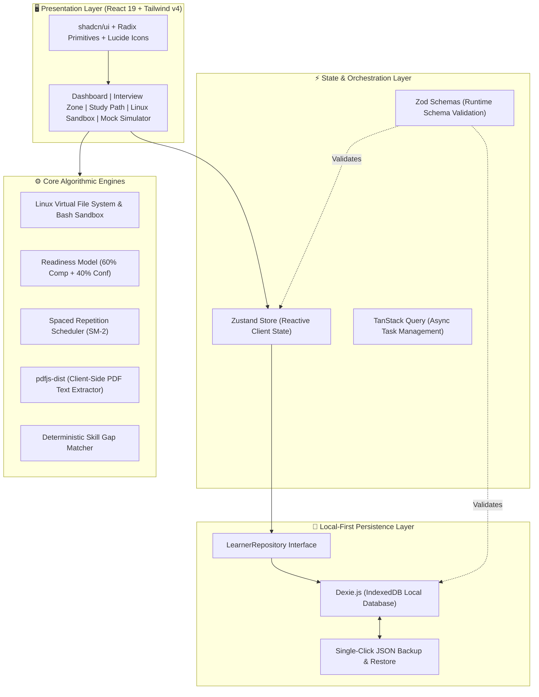
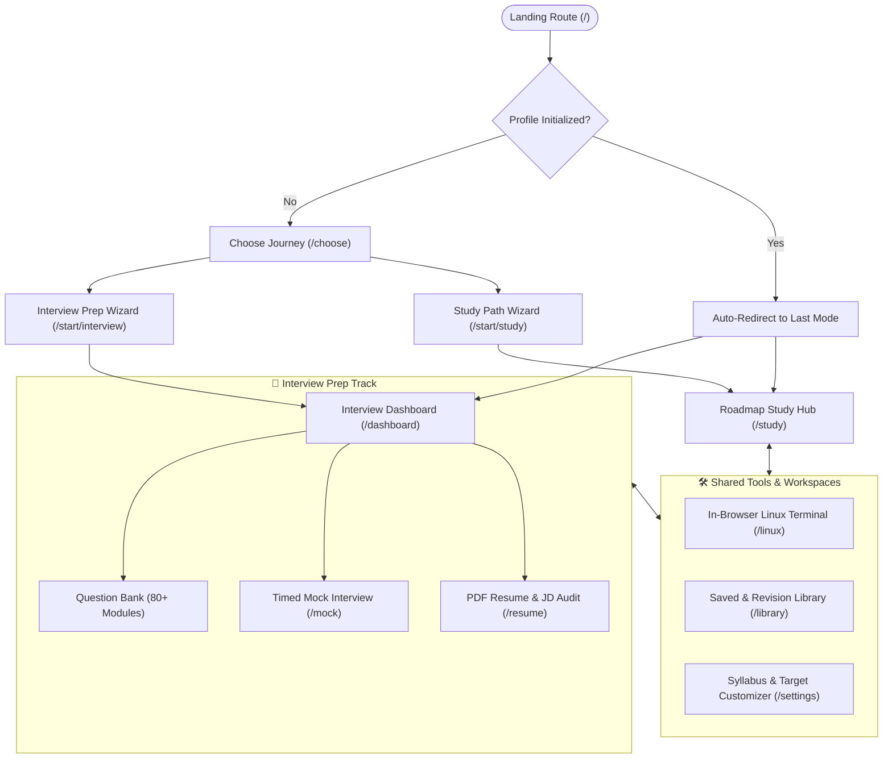
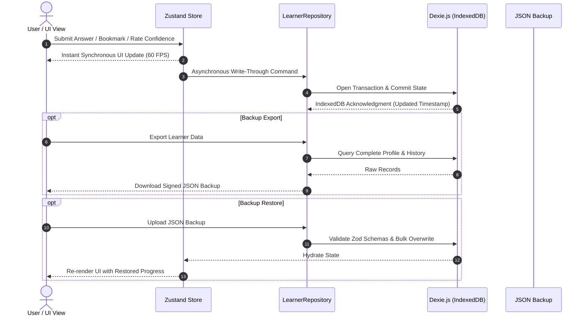
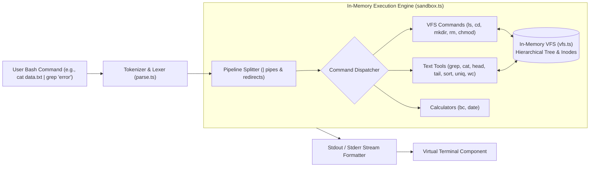
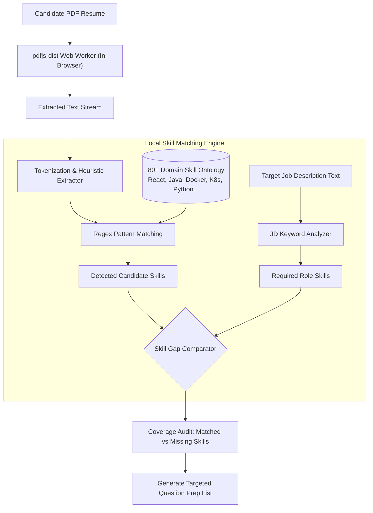
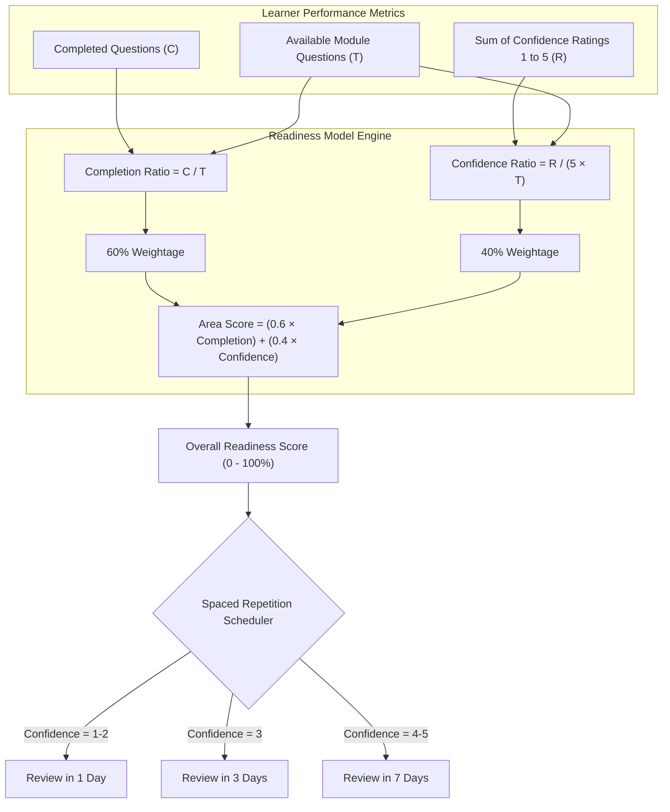
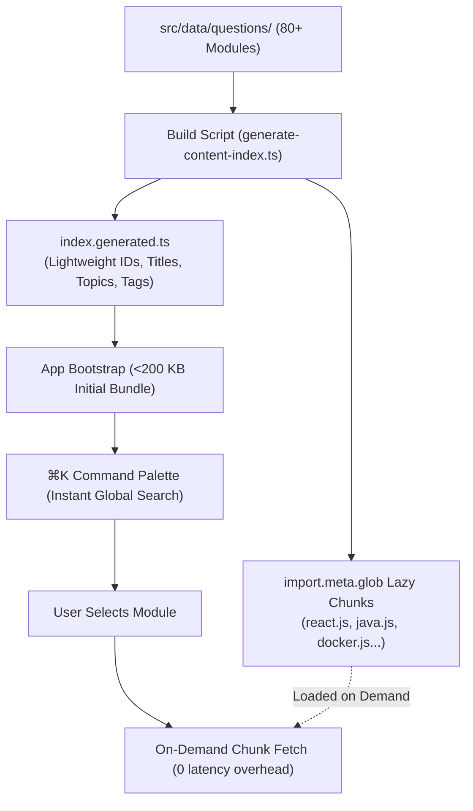

# LastRev 🚀
> **Local-First, Privacy-Centric Career Preparation & Interview Readiness Platform**

[](https://react.dev/)
[](https://www.typescriptlang.org/)
[](https://vitejs.dev/)
[](https://tailwindcss.com/)
[-success.svg)](https://dexie.org/)
[](https://vitest.dev/)
[](LICENSE)

---

## 🌟 Overview

**LastRev** is a production-grade, local-first web application designed for comprehensive technical interview preparation and career readiness. Running entirely in the browser with **zero backend servers**, it ensures 100% user data privacy, sub-10ms offline query latencies, and zero infrastructure costs.

---

## 🗺️ 1. High-Level System Architecture

The application decouples the presentation layer from the persistence layer through a clean Repository Pattern and a write-through reactive state store.



---

## 🔄 2. Dual Learner Journeys & Route State

Learners can switch between structured roadmap learning and intensive interview preparation without duplicate progress records.



---

## 💾 3. Local-First Write-Through Storage Flow

All user interactions render at 60 FPS immediately while persistence operations commit asynchronously in the background.



---

## 🖥️ 4. In-Browser Linux Terminal Engine (`src/features/linux/engine`)

Executes shell commands entirely within browser memory using an abstract Virtual File System.



---

## 📄 5. Client-Side Resume Parsing & Skill Gap Engine (`src/features/resume`)

Extracts resume text and compares candidate competencies against target job descriptions with zero server uploads.



---

## 🧠 6. Deterministic Readiness & Spaced Repetition Formula

Readiness balances factual curriculum coverage with candid self-assessed confidence.



---

## 📦 7. Content Scalability & Code-Splitting

80+ modules are dynamically partitioned into lightweight chunks to guarantee instant initial page loads.



---

## 🛠️ Tech Stack & Dependencies

| Layer | Tools & Libraries | Architectural Purpose |
|---|---|---|
| **Core Framework** | React 19, TypeScript, Vite 8 | Strict typing, sub-second HMR, and modern concurrent features |
| **Design System** | Tailwind CSS v4, shadcn/ui (Radix UI), Lucide Icons | Accessible (WCAG 2.1 AA), responsive, themeable UI |
| **Data Visuals** | Recharts | Dynamic readiness and syllabus completion charts |
| **State Management** | Zustand, TanStack Query, React Router v8 | Single source of truth with write-through cache abstraction |
| **Local Storage** | Dexie.js (IndexedDB wrapper) | Client-side transactions, zero-cost data persistence |
| **Parsing & Rules** | Zod, `pdfjs-dist`, React Hook Form | Runtime data contracts and in-browser PDF stream extraction |
| **Quality & Tests** | Vitest, React Testing Library, Axe-Core | Automated unit tests and accessibility verification |

---

## 🚀 Getting Started

### Prerequisites
- **Node.js** >= 20.x
- **pnpm** >= 9.x

### Quick Installation

```bash
# 1. Clone the repository
git clone https://github.com/your-username/last-rev.git
cd last-rev

# 2. Install dependencies
pnpm install

# 3. Start local development server (indexes content automatically)
pnpm dev
```

### Verification & Testing

```bash
# Run typechecks, linters, and unit tests
pnpm check

# Create production build
pnpm build

# Preview production build locally
pnpm preview
```

---

## 📁 Repository Structure

```
src/
├── app/            # Application router, layouts, navigation registry
├── components/     # UI primitives (shadcn), shared widgets, navigation bars
├── data/           # 80+ engineering modules, roadmaps, and question banks
├── features/       # Modular business domains:
│   ├── dashboard/   # Daily targets, streak tracking, readiness summaries
│   ├── interview/   # Question bank, module browser, bookmarking
│   ├── linux/       # In-browser virtual bash shell, VFS, and exercises
│   ├── mock/        # Timed mock interview simulator and rating panels
│   ├── resume/      # Client-side PDF parser and skill coverage auditor
│   ├── job-match/   # Job description keyword and skill gap analysis
│   └── study/       # Structured syllabus roadmaps and time-planning models
├── services/       # Core business logic (analytics, revision, storage, curriculum)
├── stores/         # Zustand store with write-through persistence
└── types/          # Zod schemas and inferred TypeScript types
```

---

## 📄 License

Distributed under the [MIT License](LICENSE).
